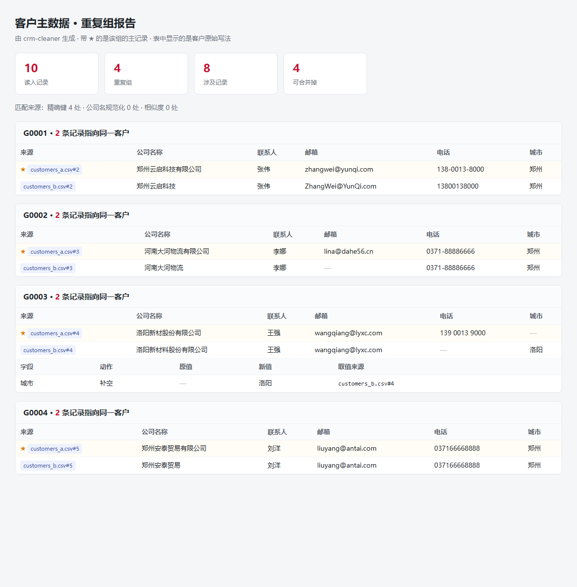

# crm-cleaner

[](https://github.com/Cix1125/crm-cleaner/actions/workflows/ci.yml)

**客户主数据清洗与去重** —— 给 CRM 实施、数据迁移和系统切换用的小工具。

把几份**格式不一致**的客户名单合并、清洗、判重，输出**主数据 + 重复组报告 + 变更日志**。

> **运行时零第三方依赖。** 只用 Python 标准库，`git clone` 下来就能跑，不用 `pip install` 任何东西。

---



> 上面是 `out/duplicates.html` 的实际输出：每一组重复客户、每条记录的来源（文件#行号）、哪条被选为主记录（★），以及字段级的变更明细。

## 它解决什么问题

CRM 系统上线、数据迁移的时候，第一道坎永远是客户数据乱：

- 同一个客户，三张表里三个写法：`郑州云启科技有限公司` / `郑州云启科技` / `郑州云启科技（郑州）`
- 邮箱大小写不一致（`ZhangWei@YunQi.com` 和 `zhangwei@yunqi.com`）
- 电话带横杠、带空格、带括号、带国家码
- 不同系统导出的表，**同一件事列名不一样**：一个叫「公司名称」，一个叫「客户名称」
- 一批数据合并完了，**没人说得清到底合并了哪些、改了什么**

现在普遍是拿 Excel 一行行看。这个工具把它自动化，并且**留下可追溯的变更日志**。

---

## 快速开始

不用装任何东西，Python 3.11+ 即可。

```bash
git clone https://github.com/Cix1125/crm-cleaner.git
cd crm-cleaner

python -m crm_cleaner \
  -i examples/customers_a.csv examples/customers_b.csv \
  -r examples/rules.toml \
  -o out
```

输出：

```
读入 10 条记录，来自 2 个文件
  customers_a.csv：认到 5 个字段（没认到：更新时间）
  customers_b.csv：认到 5 个字段（没认到：更新时间）
发现 4 组重复客户
合并后主数据 6 条，变更日志 1 条

输出：
  out/master.csv
  out/duplicates.html
  out/changes.csv
```

用浏览器打开 `out/duplicates.html`，能看到每一组重复客户、每条记录的来源，以及哪条被选为主记录。

### 命令行参数

| 参数 | 说明 |
|---|---|
| `-i, --input` | 一个或多个客户名单 CSV（列名可以不一样） |
| `-r, --rules` | 规则文件（TOML）。不填则用内置默认规则 |
| `-o, --outdir` | 输出目录，默认 `out/` |
| `-q, --quiet` | 只输出结果，不打印过程 |
| `--version` | 版本号 |

### 退出码

方便接 CI：

| 码 | 含义 |
|---|---|
| `0` | 跑通，没有发现重复 |
| `1` | 跑通，**发现了重复**（有需要人工确认的东西） |
| `2` | 运行出错（文件读不了、规则写错等） |

---

## 判重是怎么做的

只比一个字段都会出事，所以分三层，从「绝对可靠」到「可能相似」：

| 层 | 规则 | 说明 |
|---|---|---|
| **1 · 精确键** | 邮箱或电话完全相同（归一化之后） | 最可靠，几乎不会误判 |
| **2 · 规范化** | 公司名去掉法律形式后缀后相同 | `郑州云启科技有限公司` 和 `郑州云启科技` 判为同一家 |
| **3 · 相似度** | `difflib` 相似度 ≥ 阈值（默认 0.88） | 兜底。`洛阳新材` 和 `洛阳新材料` 相似度 0.889 |

**分组用并查集（union-find）。** 因为重复是传递的：A 和 B 邮箱相同、B 和 C 公司名相同 → A、B、C 是同一家。并查集处理这种传递关系比递归清爽得多。

### 一层一层调

相似度阈值是**唯一需要调**的参数：

- **定高了会漏**：`洛阳新材` 和 `洛阳新材料` 相似度 0.889，阈值设 0.9 就抓不到
- **定低了会误合并**：`河南云启信息技术` 和 `郑州云启科技` 前两个字一样但完全是两家公司

所以默认 0.88，并且**相似度那一层的结果建议人工过一遍**（报告里会标出是第几层匹配的）。

---

## 规则配置

用 TOML 写 —— Python 3.11 起 `tomllib` 进了标准库，所以规则文件也不需要 PyYAML 之类的依赖。

```toml
# 字段认领：不同系统导出来的表，同一件事叫不同名字
[columns]
company = ["公司名称", "客户名称", "公司", "company", "company_name"]
email   = ["邮箱", "电子邮箱", "email", "e-mail"]
phone   = ["电话", "手机", "联系电话", "phone", "tel", "mobile"]

[normalize]
# 公司名「XX(上海)」和「XX(北京)」是两家公司，默认不去括号
strip_parentheses = false

[match]
exact_keys = ["email", "phone"]
company_key = true
similarity_threshold = 0.88
similarity_prefilter = true

[merge]
# most_complete / source_priority / latest
master_policy = "most_complete"
fill_empty_from_others = true
```

完整注释版见 [`examples/rules.toml`](examples/rules.toml)。

---

## 输出说明

### `master.csv` —— 清洗后的主数据

每个客户一行。表头是中文，末尾附两个来源标记：

| 列 | 说明 |
|---|---|
| `公司名称` … `更新时间` | 规范化字段。**保留客户原始写法**，只做格式清洗，不改内容 |
| `_重复组` | 如果这条来自一个重复组，标上组号（如 `G0001`）；否则为空 |
| `_来源` | 主记录来自哪个文件第几行（如 `customers_a.csv#2`） |

### `duplicates.html` —— 重复组报告

给业务人员看的。每一组列出所有成员、标出主记录（★）、并列出变更明细。
**设计原则：原始值一个字都不美化** —— 客户要能认出自己的数据。

### `changes.csv` —— 变更日志

迁移完必须能回答「到底动了什么」。每一行记录：

| 列 | 说明 |
|---|---|
| `组内记录数` | 这组有几条 |
| `字段` / `动作` / `原值` / `新值` | 做了什么 |
| `取值来源` / `主记录来源` | 从哪条取的、主记录是哪条 |

---

## 设计取舍（以及为什么）

**为什么零依赖？**
数据迁移经常在客户内网做，装包要走审批。一个不需要 `pip install` 的工具，才能真的被用起来。TOML 配置、`difflib` 相似度、`sqlite3`、HTML 报告，标准库全都有。

**为什么默认不删公司名里的括号？**
`云启科技(上海)` 和 `云启科技(北京)` 是两家公司。删括号会错误合并。
只有当括号里明确是备注、不是地区/分支时，才在规则里打开 `strip_parentheses`。

**为什么保留原始值、不做「美化」？**
工具的职责是**合并重复**，不是**改内容**。动了客户的原始数据却没说清楚，比不合并更糟。
所以主数据里存的是主记录的原文，改动全部记在变更日志里。

**为什么相似度那层要按首字预过滤？**
两两比较是 O(N²)。公司名首字不同的，相似度几乎不可能过阈值，跳过能省掉大量比较。
这是一个「用一点点召回率换大量性能」的取舍，可以用 `similarity_prefilter = false` 关掉。

---

## 测试

```bash
python -m unittest discover -s tests -v
```

35 个用例，覆盖归一化规则、并查集传递性、三层匹配、CLI 端到端、GBK 编码、跨文件列名不一致等。

**不需要安装任何东西** —— 用标准库 `unittest` 写的。

> 装过 pytest 的话，同一套测试也能直接跑（pytest 兼容 `unittest.TestCase`）：
>
> ```bash
> pip install -e ".[dev]"
> pytest -q
> ```
>
> 这里刻意**不把 pytest 作为必需项**：数据迁移经常在客户内网做，装包要走审批。
> 一个连测试都不需要联网装包的项目，才更容易被别人 clone 下来真的跑起来。

---

## 已知限制

诚实写在这里，避免误用：

- **没有模糊匹配以外的智能判断**。相似度阈值永远需要人工过一遍，工具只负责把候选找出来、把工作量从「逐条看」降到「看报告」
- **只支持 CSV 输入**。Excel 需要先另存为 CSV
- **相似度算法是 `difflib.SequenceMatcher`**，对中文字符串是字符级比较，不懂拼音/简称。`郑煤机` 和 `郑州煤矿机械集团` 这种关系它抓不到
- **没有性能优化**。相似度那层是 O(N²)，实测几万条还行，十万级以上需要换索引方案
- **个人项目，未在真实生产环境使用过**。示例数据是虚构的

---

## 后续可能做的

- [ ] Excel (.xlsx) 直接输入（需要 `openpyxl`，会打破零依赖，考虑做成可选）
- [ ] 拼音/简称匹配（`郑煤机` ↔ `郑州煤矿机械集团`）
- [ ] 结果回写：生成「合并操作清单」，让 CRM 可以直接执行
- [ ] 命令行调参：`--threshold 0.9` 覆盖规则文件

---

## License

MIT
